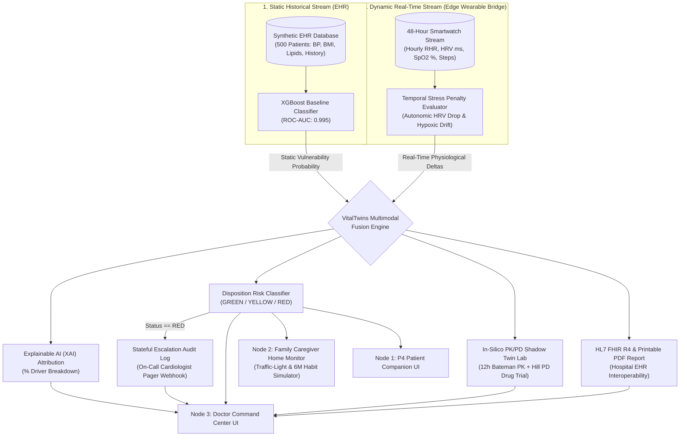

# 🫀 VitalTwins: Mechanistic PK/PD & Multimodal Predictive Cardiovascular Digital Twin
**Happiest Health Digital Twin Challenge 2026 — Reimagining and Reforming Healthcare in India Summit, Bengaluru**

[](https://opensource.org/licenses/MIT)
[](https://hl7.org/fhir/R4/)
[](https://fastapi.tiangolo.com/)
[](https://nextjs.org/)

---

## 📋 1. Team Details & College/Incubator Information
- **Team Name:** Ctrl Win
- **Submission Folder / Repo Format:** `Ctrl Win_PCCOE`
- **Team Leader & Developer:** Parth Kulkarni (B.E. Computer Engineering)
- **Institution:** Pimpri Chinchwad College of Engineering (PCCOE), Pune, Maharashtra, India
- **Incubator / Academic Affiliation:** Department of Computer Engineering & Institution's Innovation Council (IIC), PCCOE Pune

---

## 🎯 2. Project Title
**VitalTwins:** A Tri-Node Multimodal Patient Digital Twin Ecosystem Integrating Machine Learning Risk Prediction with Mechanistic Pharmacokinetic/Pharmacodynamic (PK/PD) *In-Silico* Drug Trials, Family Caregiver Monitoring, Explainable AI (XAI), and HL7 FHIR R4 Interoperability.

---

## 🚨 3. Problem Statement
Cardiovascular disease (CVD) is the leading cause of mortality in India, increasingly affecting adults aged 25–65 due to silent progression of hypertension, diabetes, and autonomic stress. Current clinical care in India is fundamentally **reactive**:
1. **Fragmented Data Silos:** Static Electronic Health Records (EHRs—blood pressure history, lipid profiles, comorbidities) sit isolated in hospital databases, completely disconnected from continuous physiological signals captured by consumer wearables.
2. **Missed Prodromal Windows & Household Blind Spots:** Subtle autonomic nervous system degradations—such as progressive drops in Heart Rate Variability (HRV), resting tachycardia spikes, and mild nocturnal $\text{SpO}_2$ desaturation—occur **12 to 48 hours before** an acute arrhythmic event, but family members at home have no simplified way to monitor an elderly parent without deciphering complex medical charts.
3. **Trial-and-Error Prescribing & Black-Box AI Distrust:** Clinicians hesitate to adopt black-box AI triage alerts that fail to explain *which* physiological factor triggered the alarm, and lack a safe, patient-specific virtual sandbox to test how antiarrhythmic or beta-blocker dosages will affect a patient's heart rate before writing a real prescription.

---

## 🏥 4. Healthcare Use Case & Ground-Level Tri-Node Ecosystem
**VitalTwins** bridges the gap between the patient's wrist, their family household, and the hospital cardiologist through a **Tri-Node Deployment Architecture**:

1. **Node 1 — The Edge Wearable Ingestion Bridge (Wrist-to-Cloud):**
   - Ingests continuous hourly biometric packets ($\text{RHR}$, $\text{HRV}$, $\text{SpO}_2$, step activity) via a simulated **Google Health Connect / Apple HealthKit BLE Bridge** and fuses them with static EHR vulnerability.
2. **Node 2 — Family Caregiver Home Monitor & 6-Month Habit Simulator (Household Level):**
   - Empowering Indian households where elderly cardiac care is family-driven: provides relatives with a jargon-free **"Traffic-Light" Remote Monitor** (Green = Comfortable, Yellow = Elevated Stress, Red = Immediate Check-In) alongside an interactive **6-Month Preventive Lifestyle Twin Simulator** showing how gradual weight reduction and daily walking lower baseline cardiac vulnerability.
3. **Node 3 — Doctor Command Center & In-Silico PK/PD Drug Lab (Clinical Level):**
   - **In-Silico PK/PD Shadow Twin Drug Simulator:** Spawns four parallel virtual clones of the patient to simulate 12-hour counterfactual trajectories under candidate medications (**Metoprolol 25mg**, **Metoprolol 50mg**, **Ivabradine 5mg**, **Amiodarone 200mg**), automatically ranking the safest drug while flagging **iatrogenic bradycardia risks ($<55\text{ bpm}$)**.
   - **Explainable Clinical Decision Handoff (XAI) & Printable PDF Chart:** Decomposes exact percentage risk drivers and exports a formal, printable **Clinical Handoff PDF Report** and **HL7 FHIR R4 Bundle**.
   - **Stateful Emergency Escalation Audit Trail:** Fires automated pager/WhatsApp webhooks to the on-call cardiologist with real-time acknowledgment tracking.
   - **P4 Participatory Patient Companion:** Translates alerts into calm, non-alarmist breathing and rest guidance on the patient's mobile view.

---

## 🛠️ 5. Technical Stack
| Layer | Technologies Used | Purpose |
| :--- | :--- | :--- |
| **Frontend UI Dashboard** | Next.js (App Router), React, TypeScript, Tailwind CSS, Lucide Icons, Custom SVG Charting | Tri-mode UI (Doctor Command Center, Family Caregiver Monitor & P4 Patient Companion), Printable PDF Report Generator, and FHIR JSON Inspector |
| **Backend API & Twin Engine** | Python 3, FastAPI, Uvicorn, Pydantic | Low-latency REST API serving synchronized Digital Twin states, 12h PK/PD differential simulations, XAI attributions, and stateful escalation audit logs |
| **AI / Machine Learning & Physics** | XGBoost (`xgboost`), Scikit-Learn (`scikit-learn`), Bateman PK & Hill PD Mechanistic Models | Static EHR baseline risk probability modeling fused with dynamic time-series telemetry penalties and personalized pharmacokinetic/pharmacodynamic equations |
| **Healthcare Interoperability** | HL7 FHIR R4 Standard (`Bundle`, `Patient`, `Observation`, `RiskAssessment`) | Standardized hospital EHR export using LOINC physiological coding (`8867-4`, `80404-7`, `59408-5`) |
| **Sandbox Data Generation** | Custom Synthetic Physiological & EHR Generator (DPDP Act & HIPAA Safe) | Generates 500 synthetic Indian patient EHR cohorts and 4 distinct 48-hour clinical wearable archetypes |

---

## 🧠 6. AI/ML Model & Mechanistic Digital Twin Framework

### 6.1 Multimodal Data Stream Architecture & 4 Clinical Archetypes
To comply strictly with the **DPDP Act** and **HIPAA** sandbox guidelines, VitalTwins operates on two fully synthetic, physiologically grounded data streams:
1. **Stream 1 — Static / Historical EHR Data (`backend/data/synthetic_ehr.csv`):**
   - **Cohort Size:** 500 synthetic patients (`PAT_001` to `PAT_500`).
   - **Features:** `age`, `gender`, `bmi`, `systolic_bp`, `diastolic_bp`, `cholesterol_mg_dl`, `hypertension_history`, `diabetes_history`, `smoker`.
   - **Baseline Model:** An **XGBoost Classifier** (`max_depth=4`, `n_estimators=100`, `learning_rate=0.08`) trained to output the patient's baseline cardiovascular vulnerability probability $P_{\text{EHR}} \in [0, 1]$.
   - **Validation Metrics:** Achieves **94.00% Validation Accuracy** and **0.995 ROC-AUC** on the held-out synthetic test split.

2. **Stream 2 — Dynamic / Real-Time Wearable Telemetry (`backend/data/wearable_stream.csv`):**
   - **Time-Series Horizon:** 48-hour continuous hourly stream across **4 Benchmarking Clinical Personas**:
     - **`PAT_001` (Rajesh Sharma, 61M):** Progressive autonomic collapse starting at Hour +28 (HRV drops $>35\%$ down to $26\text{ ms}$, RHR spikes $>105\text{ bpm}$).
     - **`PAT_002` (Ananya Deshmukh, 34F):** Healthy control profile with stable vagal tone ($\text{HRV} \sim 68\text{ ms}$).
     - **`PAT_003` (Sunita Mehta, 58F):** Post-Myocardial Infarction recovery profile exhibiting nocturnal hypoxic $\text{SpO}_2$ drift ($<91\%$) between Hours 30–45.
     - **`PAT_004` (Vikram Malhotra, 42M):** High-stress corporate executive exhibiting acute sympathetic tachycardia spikes ($>110\text{ bpm}$) between Hours 18–38.

### 6.2 Mathematical Formulation of the Multimodal Fusion Engine
At any given hour offset $t$, the Digital Twin state $S(t)$ fuses static clinical vulnerability with real-time physiological stress penalties:

$$R_{\text{fused}}(t) = \min\Big(1.0, \; w_1 P_{\text{EHR}} + w_2 \Phi_{\text{HRV}}(t) + w_3 \Phi_{\text{SpO2}}(t) + w_4 \Phi_{\text{HR}}(t)\Big)$$

Where:
- $w_1 = 0.45, \; w_2 = 0.30, \; w_3 = 0.15, \; w_4 = 0.10$ represent the clinical modality weights.
- $\Phi_{\text{HRV}}(t) = \max\left(0, \frac{50 - \text{HRV}(t)}{50}\right)$ captures vagal tone withdrawal when HRV drops below $50\text{ ms}$.
- $\Phi_{\text{SpO2}}(t) = \max\left(0, \frac{95 - \text{SpO}_2(t)}{10}\right)$ captures mild hypoxic drift below $95\%$.
- $\Phi_{\text{HR}}(t) = \max\left(0, \frac{\text{HR}(t) - 85}{50}\right)$ captures resting sympathetic tachycardia above $85\text{ bpm}$.

### 6.3 Explainable AI (XAI) Feature Attribution
For every prediction at hour $t$, the engine computes normalized local feature attributions $A_i(t)$ so clinicians can audit the exact driver of the risk score:

$$A_i(t) = \frac{w_i \cdot C_i(t)}{\sum_{k=1}^{4} w_k \cdot C_k(t)} \times 100\%$$

### 6.4 True Digital Twin Physics: In-Silico PK/PD Counterfactual Drug Simulator
To enable risk-free *in-silico* experimentation (`simulate_in_silico_interventions()`), the engine spawns parallel **Shadow Twins** over a 12-hour forecast horizon ($\tau \in [0, 12]\text{ hours}$):
1. **1-Compartment Oral Bateman Pharmacokinetic (PK) Equation (Blood Plasma Concentration):**
   Calculates drug absorption ($k_a$) and elimination ($k_e$) personalized to the patient's BMI-derived Volume of Distribution ($V_d$) and age-adjusted renal clearance factor:

   $$C_p(\tau) = \frac{F \cdot D \cdot k_a}{V_d (k_a - k_e)} \left(e^{-k_e \tau} - e^{-k_a \tau}\right)$$

2. **Hill Pharmacodynamic (PD) Equation (Organ-Level Heart Rate & HRV Response):**
   Computes the physiological suppression of sympathetic tachycardia and restoration of vagal HRV tone as a function of plasma concentration $C_p(\tau)$:

   $$E(\tau) = \frac{E_{\max} \cdot C_p(\tau)^n}{EC_{50}^n + C_p(\tau)^n}$$

3. **Safety Guardrail & Regimen Ranking:** Evaluates whether the simulated trajectory induces iatrogenic sinus bradycardia ($\text{HR}_{\min} < 55\text{ bpm}$) and ranks the safest, highest-efficacy regimen.

---

## 🏗️ 7. System Architecture Diagram

### Visual System Architecture


*📄 **Downloadable Architecture & Presentation Files for Evaluators:***
- **[🖼️ System Architecture Diagram (PNG)](./docs/VitalTwins_Architecture_Diagram.png)**
- **[📄 Architecture & Full Project Presentation (PDF)](./docs/VitalTwins_CtrlWin_Presentation.pdf)**
- **[📊 Architecture & Full Project Presentation (PPTX)](./docs/VitalTwins_CtrlWin_Presentation.pptx)**



---

## 🎥 8. 15–20 Minute Prototype Demonstration Video (Unlisted YouTube)

> 🔗 **Watch the Full Technical Explanation & Live Prototype Demo:**  
> **[▶️ Click Here to Watch on YouTube (Unlisted Link — Placeholder)](https://youtu.be/YOUR_UNLISTED_VIDEO_ID_HERE)**

**Video Walkthrough Timestamps:**
- `00:00 – 02:30` : Problem Statement, Clinical Gap in India, and Tri-Node Digital Twin Architecture
- `02:30 – 05:00` : DPDP-Compliant Sandbox Data Synthesis (4 Archetypes) & XGBoost Baseline Training
- `05:00 – 08:30` : Multimodal Fusion Engine, Explainable AI (XAI), and Mechanistic PK/PD Differential Equations (`fusion_engine.py`)
- `08:30 – 13:00` : Live Clinical Dashboard Demo (48h Telemetry Scrubbing, Escalation Pager Log & 12h In-Silico PK/PD Drug Trials)
- `13:00 – 16:00` : Family Caregiver Mode (6-Month Habit Simulator), Printable Clinical PDF Report, HL7 FHIR R4 Export & P4 Companion View

---

## 📊 9. Project Presentation (PDF / PPTX Format)

All project details, mathematical formulations, system architecture diagrams, and validation outcomes are included in our presentation deck located in the `docs/` directory:
- **[📄 VitalTwins Project Presentation Deck (PDF)](./docs/VitalTwins_CtrlWin_Presentation.pdf)**
- **[📊 VitalTwins Project Presentation Deck (PPTX)](./docs/VitalTwins_CtrlWin_Presentation.pptx)**

---

## 🚀 10. How to Run the Prototype Locally

### Prerequisites
- Python 3.10+
- Node.js 18+ and `npm`

### Step 1: Clone the Repository & Launch the FastAPI Backend

```bash
git clone [https://github.com/YOUR_GITHUB_USERNAME/Ctrl-Win_PCCOE.git](https://github.com/YOUR_GITHUB_USERNAME/Ctrl-Win_PCCOE.git)
cd Ctrl-Win_PCCOE

# Create and activate virtual environment
python -m venv venv
.\venv\Scripts\Activate   # On Windows PowerShell
# source venv/bin/activate # On macOS/Linux

# Install dependencies
pip install -r backend/requirements.txt

# Generate synthetic sandbox datasets and train the XGBoost model
python backend/data/generate_sandbox_data.py
python backend/models/train_models.py

# Launch FastAPI Digital Twin Server on Port 8000
python -m uvicorn backend.app:app --reload --port 8000
```

### Step 2: Launch the Next.js Clinical Dashboard

Open a second terminal window:

```bash
cd frontend
npm install
npm run dev
```

Open **`http://localhost:3000`** in your browser to interact with the live Digital Twin dashboard.

---

## 📜 11. Open-Source License Details

This project is licensed under the **MIT License** — making it completely open-source and permissive for academic research, clinical validation pilots, and healthcare incubator deployment.

```text
MIT License

Copyright (c) 2026 Team Ctrl Win (Parth Kulkarni, PCCOE Pune)

Permission is hereby granted, free of charge, to any person obtaining a copy
of this software and associated documentation files (the "Software"), to deal
in the Software without restriction, including without limitation the rights
to use, copy, modify, merge, publish, distribute, sublicense, and/or sell
copies of the Software, and to permit persons to whom the Software is
furnished to do so, subject to the following conditions:

The above copyright notice and this permission notice shall be included in all
copies or substantial portions of the Software.

THE SOFTWARE IS PROVIDED "AS IS", WITHOUT WARRANTY OF ANY KIND, EXPRESS OR
IMPLIED, INCLUDING BUT NOT LIMITED TO THE WARRANTIES OF MERCHANTABILITY,
FITNESS FOR A PARTICULAR PURPOSE AND NONINFRINGEMENT.
```